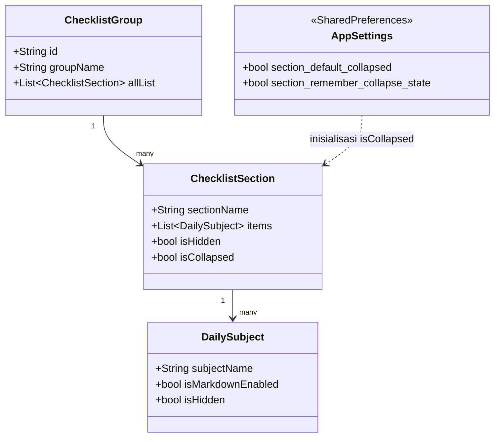

# PRD: CardChecklist — Section Features & Markdown Bug Fix

**Status:** Draft  
**Tanggal:** 2026-11-24  
**Feature Area:** `checklist` — `ChecklistDetailScreen`, `ChecklistSection`, `DailyChecklistDialog`

---

## 1. Latar Belakang

Terdapat tiga kebutuhan baru pada fitur **CardChecklist** yang perlu diselesaikan:

1. **Bug:** Mode Markdown pada catatan (note) card tidak persisten — ketika user toggle ke mode Markdown, perubahan tidak disimpan ke model, sehingga saat dialog dibuka kembali mode kembali ke nonaktif.
2. **Fitur:** Seksi (section) dapat **disembunyikan** (hidden) tanpa dihapus.
3. **Fitur:** Seksi dapat di-**collapse** (dilipat/ditutup) untuk merapikan tampilan, dengan pengaturan default global.
4. **Guard:** Ketika menghapus seksi yang masih memiliki isi (termasuk item yang tersembunyi), muncul dialog konfirmasi peringatan.

---

## 2. Masalah yang Diselesaikan

### 2.1 Bug — Markdown Mode Tidak Persisten

**Root Cause:**  
Di `checklist_dialog_controller.dart`, method `toggle_md` hanya mengubah `isMarkdownEnabled` (state lokal widget), **tanpa** memperbarui `widget.subject.isMarkdownEnabled` dan **tanpa** memanggil `onDataChanged()` atau `saveGroupData()`.

```dart
// SEKARANG (bermasalah):
setState(() {
  isMarkdownEnabled = !isMarkdownEnabled;
  isNoteModified = true;
});

// SEHARUSNYA:
setState(() {
  isMarkdownEnabled = !isMarkdownEnabled;
  widget.subject.isMarkdownEnabled = isMarkdownEnabled; // ← MISSING
  isNoteModified = true;
});
widget.onDataChanged(); // ← MISSING
```

**Perilaku yang Diharapkan:**  
Saat user toggle Markdown ON/OFF, perubahan langsung disimpan ke `widget.subject.isMarkdownEnabled` dan `onDataChanged()` dipanggil, sehingga data persisten ke file.

---

## 3. Spesifikasi Fitur

### 3.1 Fitur: Sembunyikan Seksi (Section Hide)

**Deskripsi:**  
User dapat menyembunyikan sebuah seksi beserta semua item di dalamnya dari tampilan utama. Seksi yang disembunyikan tidak terhapus — hanya tersembunyi.

**Model Changes:**  
Tambahkan field `isHidden` pada `ChecklistSection`:

```dart
class ChecklistSection {
  String sectionName;
  List<DailySubject> items;
  bool isHidden; // ← BARU (default: false)
  bool isCollapsed; // ← BARU (lihat 3.2)

  ChecklistSection({
    required this.sectionName,
    required this.items,
    this.isHidden = false,
    this.isCollapsed = false,
  });

  factory ChecklistSection.fromJson(Map<String, dynamic> json) {
    // ...
    return ChecklistSection(
      sectionName: json['nama_seksi'] ?? 'Seksi Baru',
      items: list.map((i) => DailySubject.fromJson(i)).toList(),
      isHidden: json['isHidden'] ?? false,
      isCollapsed: json['isCollapsed'] ?? false,
    );
  }

  Map<String, dynamic> toJson() {
    return {
      'nama_seksi': sectionName,
      'items': items.map((e) => e.toJson()).toList(),
      'isHidden': isHidden,
      'isCollapsed': isCollapsed,
    };
  }
}
```

**UI:**

| Elemen | Detail |
|---|---|
| **Lokasi aksi** | Header seksi — ikon di trailing row (kanan nama seksi) |
| **Ikon status** | `Icons.visibility_off` jika disembunyikan, `Icons.visibility` jika tampil |
| **Indikator** | Ikon perisai/shield (atau `visibility_off`) selalu terlihat di kanan header jika seksi sedang disembunyikan |
| **Unhide** | Muncul tombol "Tampilkan Seksi Tersembunyi" di bagian bawah halaman (atau di panel filter global), lalu tap ikon visibility untuk unhide |
| **Render** | Seksi dengan `isHidden = true` **tidak dirender** (di-filter sebelum build), kecuali mode "tampilkan tersembunyi" aktif |

**Alur:**
```
User tap ikon 👁️ di header seksi
  → setState: section.isHidden = true
  → saveGroupData()
  → Seksi hilang dari tampilan (filtered)
  
User aktifkan "Tampilkan Tersembunyi"
  → Section tetap dirender tapi dengan indikator visual berbeda (opacity/warna redup)
  → Ikon 👁️ di header untuk toggle kembali tampil
```

---

### 3.2 Fitur: Collapse Seksi (Section Collapse)

**Deskripsi:**  
User dapat melipat/membuka isi sebuah seksi langsung di tampilan. Ketika terlipat (`isCollapsed = true`), hanya header seksi yang tampil — isinya disembunyikan sementara. Berbeda dari **Sembunyikan** (hide): collapse hanya tentang tampilan lipatan, bukan tentang visibilitas total.

**Perbedaan Sembunyikan vs Collapse:**

| Aspek | Sembunyikan (isHidden) | Collapse (isCollapsed) |
|---|---|---|
| Efek | Seksi hilang sepenuhnya dari daftar | Header tetap ada, isi terlipat |
| Tujuan | Menyingkirkan seksi yang tidak relevan saat ini | Merapikan tampilan tanpa kehilangan konteks |
| Persistence | Tersimpan di model (JSON) | Tersimpan di model JIKA "remember state" aktif |
| Trigger | Ikon di header (mode edit atau selalu) | Ketuk header / ikon chevron |

**Model Changes:**  
Field `isCollapsed` pada `ChecklistSection` (lihat 3.1 di atas).

**Settings Global (SharedPreferences):**

| Key | Type | Default | Deskripsi |
|---|---|---|---|
| `section_default_collapsed` | `bool` | `false` | Apakah seksi baru atau yang belum punya state tersimpan akan dimulai terlipat |
| `section_remember_collapse_state` | `bool` | `true` | Apakah state collapse per-seksi diingat setelah app ditutup-buka |

**Logika Inisialisasi Collapse State:**

```
Saat ChecklistDetailScreen dibuka:
  Untuk setiap section:
    if (remember_state = true)
      → gunakan section.isCollapsed dari model
    else
      → gunakan SharedPreferences['section_default_collapsed']
```

**UI:**

| Elemen | Detail |
|---|---|
| **Trigger** | Tap header seksi ATAU tap ikon `ChevronRight`/`ChevronDown` di kiri nama seksi |
| **Ikon collapse** | `Icons.chevron_right` = terlipat, `Icons.expand_more` = terbuka |
| **Animasi** | `AnimatedContainer` atau `AnimatedCrossFade` untuk smooth expand/collapse |
| **State terlipat** | Hanya header seksi yang terlihat, isi tidak dirender (atau height=0) |

**Lokasi Setting UI:**  
Di halaman pengaturan app (Settings screen), tambahkan section "Tampilan Checklist":
- Toggle: "Tutup seksi secara default" (`section_default_collapsed`)
- Toggle: "Ingat status lipatan seksi" (`section_remember_collapse_state`)

---

### 3.3 Guard: Peringatan Hapus Seksi dengan Isi

**Deskripsi:**  
Saat user menghapus sebuah seksi, sistem memeriksa apakah seksi masih memiliki item (termasuk item yang `isHidden = true`). Jika ya, muncul dialog konfirmasi peringatan sebelum penghapusan dilanjutkan.

**Kondisi Peringatan:**
```dart
bool shouldWarn = section.items.isNotEmpty;
// items yang isHidden=true TETAP dihitung
```

**Dialog Konfirmasi:**

```
┌─────────────────────────────────────┐
│ ⚠️  Hapus Seksi?                     │
│                                     │
│ Seksi "Nama Seksi" masih memiliki   │
│ 5 item (termasuk 2 yang            │
│ disembunyikan). Semua item akan     │
│ terhapus permanen.                  │
│                                     │
│ [Batal]            [Hapus Semua]    │
└─────────────────────────────────────┘
```

**Komponen dialog:**
- Icon: `Icons.warning_amber_rounded` (warna amber/oranye)
- Judul: `"Hapus Seksi?"`
- Konten: nama seksi + jumlah total item + jumlah item tersembunyi (jika ada)
- Tombol Batal: `TextButton` (grey)
- Tombol Hapus: `ElevatedButton` warna `Colors.red`

**Jika seksi kosong:** Langsung hapus tanpa dialog.

---

## 4. Lokasi File yang Perlu Dimodifikasi

| File | Perubahan |
|---|---|
| `lib/features/checklist/data/models/daily_model.dart` | Tambah `isHidden`, `isCollapsed` pada `ChecklistSection` + update `fromJson`/`toJson` |
| `lib/features/checklist/presentation/checklist_detail_screen/controllers/checklist_dialog_controller.dart` | Fix bug: sync `widget.subject.isMarkdownEnabled` + panggil `onDataChanged()` saat toggle_md |
| `lib/features/checklist/presentation/checklist_detail_screen/checklist_detail_screen.dart` | Render logic: filter section `isHidden`, render collapse (chevron + AnimatedContainer), guard hapus seksi |
| `lib/features/checklist/presentation/checklist_detail_screen/controllers/checklist_detail_controller.dart` | Method `deleteSection()` dengan guard, method `toggleSectionHidden()`, `toggleSectionCollapsed()` |
| `lib/core/presentation/widgets/interactive_section_header.dart` | Tambah parameter: collapse icon (chevron), visibility icon, callbacks |
| `lib/features/settings/` _(atau existing settings screen)_ | Tambah dua toggle setting untuk default collapse & remember state |

---

## 5. Domain Model



---

## 6. Acceptance Criteria

### Bug Fix — Markdown Persist
- [ ] Toggle Markdown ON → `widget.subject.isMarkdownEnabled = true` + `onDataChanged()` dipanggil
- [ ] Tutup dialog → Buka kembali → Status Markdown tetap ON
- [ ] Toggle Markdown OFF → tersimpan & persisten

### Sembunyikan Seksi
- [ ] Ikon visibility di header seksi → tap → seksi hilang dari tampilan
- [ ] Data dalam seksi yang disembunyikan **tidak terhapus**
- [ ] Tersedia cara untuk menampilkan kembali seksi tersembunyi
- [ ] `isHidden` tersimpan ke JSON melalui `saveGroupData()`

### Collapse Seksi
- [ ] Tap header seksi / ikon chevron → isi terlipat dengan animasi
- [ ] Ikon chevron berubah arah sesuai state
- [ ] Setting global "default tutup" berlaku untuk seksi baru
- [ ] Jika "remember state" ON → state tersimpan di model dan persisten
- [ ] Jika "remember state" OFF → setiap buka, gunakan nilai default global
- [ ] Setting tersedia di halaman pengaturan app

### Peringatan Hapus Seksi
- [ ] Hapus seksi yang memiliki items → dialog konfirmasi muncul
- [ ] Dialog menampilkan nama seksi + jumlah total item + jumlah hidden item
- [ ] Tekan Batal → tidak ada yang terhapus
- [ ] Tekan Hapus Semua → seksi dan semua isinya terhapus
- [ ] Hapus seksi kosong → langsung terhapus tanpa dialog

---

## 7. Open Questions

> [!NOTE]
> Pertanyaan-pertanyaan ini tidak dibahas dalam grilling dan perlu dikonfirmasi sebelum implementasi.

1. **Lokasi UI "Tampilkan Semua Seksi Tersembunyi"** — apakah sebagai toggle di AppBar halaman detail, atau sebagai tombol di bagian bawah daftar seksi?
2. **InteractiveSectionHeader** — apakah perubahan widget ini backward-compatible atau perlu migrasi caller lain yang menggunakan widget ini?
3. **Animasi collapse** — apakah menggunakan `AnimatedContainer`, `ExpansionTile`, atau `AnimatedCrossFade`? (`ExpansionTile` sudah built-in Material, bisa mempercepat implementasi)
