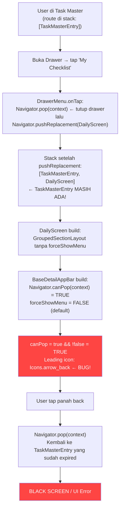

# SPEC — AppBar Leading Button Wrong Icon on Navigation

**Nomor Masalah:** BUG-001  
**Tanggal:** 2026-11-23  
**Referensi PRD:** `PRD.md` di folder yang sama  
**Status:** `READY FOR IMPLEMENTATION`  

---

## 1. Root Cause Analysis

### 1.1 Diagram Alur Masalah



### 1.2 Penjelasan Teknis

**File:** `lib/core/presentation/widgets/base_detail_app_bar.dart`  
**Baris kritis:** 50

```dart
// MASALAH: canPop hanya dikontrol oleh forceShowMenu
// forceShowMenu = false (default) → logika sepenuhnya bergantung pada Navigator.canPop()
final bool canPop = Navigator.canPop(context) && !forceShowMenu;
```

**Mengapa `Navigator.canPop()` mengembalikan `true`?**

Ketika `DrawerMenu` memanggil:
```dart
Navigator.pop(context);               // 1. tutup drawer (pop overlay)
Navigator.pushReplacement(context, MaterialPageRoute(...DailyScreen));  // 2. replace rute teratas
```

`pushReplacement` **hanya mengganti rute paling atas** di stack. Rute-rute di bawahnya (dalam hal ini `TaskMasterEntry`) **tetap ada di stack**. Oleh karena itu `Navigator.canPop()` mengembalikan `true` karena ada rute yang bisa di-pop.

**Visualisasi Navigator Stack:**

```
Sebelum navigasi:    Setelah pushReplacement:
┌──────────────┐     ┌──────────────┐
│ TaskMaster   │  →  │  DailyScreen │  ← rute aktif (baru)
└──────────────┘     ├──────────────┤
                     │ TaskMaster   │  ← masih ada! canPop = true
                     └──────────────┘
```

**Mengapa Task Master tidak terdampak?**

Task Master secara eksplisit meneruskan `forceShowMenu: true`:
```dart
// task_master_screen.dart baris 693
appBar: BaseDetailAppBar(
  ...
  forceShowMenu: true,  // ← ini yang menyelamatkan Task Master
  ...
),
```

Namun semua screen lain yang menggunakan `GroupedSectionLayout` **tidak ada cara untuk meneruskan** `forceShowMenu` ke `BaseDetailAppBar` karena `GroupedSectionLayout` tidak menyediakan parameter tersebut.

---

## 2. Solusi yang Diusulkan

### 2.1 Strategi Fix

**Pilihan A — Tambah `forceShowMenu` di `GroupedSectionLayout`** *(Recommended)*  
Tambahkan parameter `forceShowMenu` ke `GroupedSectionLayout`, lalu teruskan ke `BaseDetailAppBar`. Setiap screen yang merupakan halaman root navigator passes `forceShowMenu: true`.

**Pilihan B — Ubah default `forceShowMenu` jadi `true` di `GroupedSectionLayout`**  
Karena semua screen yang memakai `GroupedSectionLayout` adalah root-level screen, default bisa langsung `true` tanpa perlu tiap screen men-pass-nya. Namun ini kurang eksplisit.

**Pilihan C — Gunakan `NavigatorObserver` global untuk tracking**  
Over-engineered untuk masalah ini.

> **Rekomendasi: Pilihan A atau B**, dengan B sebagai quick fix dan A sebagai solusi yang lebih proper.

### 2.2 Detail Implementasi

#### [MODIFY] `base_detail_app_bar.dart`
Tidak ada perubahan yang diperlukan — logika `forceShowMenu` sudah benar.

#### [MODIFY] `grouped_section_layout.dart`

Tambahkan parameter `forceShowMenu`:

```dart
// Sebelum (tidak ada parameter forceShowMenu):
class GroupedSectionLayout<T> extends StatefulWidget {
  final String title;
  final Widget? drawer;
  // ...

// Sesudah:
class GroupedSectionLayout<T> extends StatefulWidget {
  final String title;
  final Widget? drawer;
  final bool forceShowMenu;  // ← TAMBAH INI
  // ...
```

Tambahkan ke constructor:
```dart
const GroupedSectionLayout({
  super.key,
  required this.title,
  this.drawer,
  this.forceShowMenu = true,  // ← default true karena semua pemakai adalah root-screen
  // ...
```

Teruskan ke `BaseDetailAppBar` di method `build`:
```dart
appBar: BaseDetailAppBar(
  pageTitle: widget.title,
  forceShowMenu: widget.forceShowMenu,  // ← TAMBAH INI
  isSelectMode: widget.isSelectMode,
  // ...
```

#### [MODIFY] Screen-screen yang menggunakan `GroupedSectionLayout`

Tambahkan `forceShowMenu: true` ke semua root screen:

**`checklist_screen.dart`:**
```dart
body: GroupedSectionLayout<ChecklistGroup>(
  title: 'Checklist Groups',
  forceShowMenu: true,  // ← TAMBAH
  drawer: const DrawerMenu(isDailyActive: true),
  // ...
```

**`note_screen.dart`:**
```dart
body: GroupedSectionLayout<NoteGroup>(
  title: 'My Notes',
  forceShowMenu: true,  // ← TAMBAH
  drawer: const DrawerMenu(isNotesActive: true),
  // ...
```

**`prompt_screen.dart`:**
```dart
body: GroupedSectionLayout<PromptGroup>(
  title: 'My Prompt',
  forceShowMenu: true,  // ← TAMBAH
  drawer: const DrawerMenu(isPromptActive: true),
  // ...
```

**`document_screen.dart`:**
```dart
body: GroupedSectionLayout<DocumentGroup>(
  title: 'My Documents',
  forceShowMenu: true,  // ← TAMBAH
  drawer: const DrawerMenu(isDocumentsActive: true),
  // ...
```

**`checklist_detail_screen.dart`** *(cek apakah root atau sub-rute!)*:
- Jika dipush via `Navigator.push` → **JANGAN** tambahkan `forceShowMenu: true` (harus tetap tampil ←)
- Jika dipush via `Navigator.pushReplacement` atau sebagai root → tambahkan `forceShowMenu: true`

> [!IMPORTANT]  
> `checklist_detail_screen.dart` menggunakan `GroupedSectionLayout` juga. Pastikan untuk **tidak** menambahkan `forceShowMenu: true` jika screen ini diakses via `Navigator.push` dari `checklist_screen`. Cek konteks pemanggilannya.

---

## 3. File yang Harus Diubah

| File | Jenis Perubahan | Dampak |
|---|---|---|
| `lib/core/presentation/widgets/grouped_section_layout.dart` | MODIFY — tambah param `forceShowMenu` | Core widget, affects semua user |
| `lib/features/checklist/presentation/checklist_screen/checklist_screen.dart` | MODIFY — pass `forceShowMenu: true` | Root screen |
| `lib/features/notes/presentation/screens/note_screen.dart` | MODIFY — pass `forceShowMenu: true` | Root screen |
| `lib/features/prompt/presentation/screens/prompt_screen.dart` | MODIFY — pass `forceShowMenu: true` | Root screen |
| `lib/features/documents/presentation/screens/document_screen.dart` | MODIFY — pass `forceShowMenu: true` | Root screen |
| `lib/features/checklist/presentation/checklist_detail_screen/checklist_detail_screen.dart` | REVIEW — cek apakah root atau sub-rute | Detail screen |

---

## 4. Skenario Test

### 4.1 Test Navigasi Drawer (Harus PASS)

| # | Langkah | Expected Result |
|---|---|---|
| T-01 | Buka app → Task Master → lihat AppBar | Ikon ☰ (menu) tampil |
| T-02 | Dari Task Master → buka Drawer → pilih My Checklist | Ikon ☰ tampil di My Checklist |
| T-03 | Tap ☰ di My Checklist | Drawer terbuka |
| T-04 | Dari My Checklist → buka Drawer → pilih My Note | Ikon ☰ tampil di My Note |
| T-05 | Tap ☰ di My Note | Drawer terbuka |
| T-06 | Dari My Note → buka Drawer → pilih My Prompt | Ikon ☰ tampil di My Prompt |
| T-07 | Navigasi ke semua halaman via Drawer | Tidak ada layar hitam |

### 4.2 Test Navigasi Detail (Harus PASS)

| # | Langkah | Expected Result |
|---|---|---|
| T-08 | Di My Checklist → tap salah satu Group | Masuk ke Checklist Detail Screen |
| T-09 | Di Checklist Detail → lihat AppBar | Ikon ← (back) tampil |
| T-10 | Tap ← di Checklist Detail | Kembali ke My Checklist dengan benar |
| T-11 | Di My Note → tap salah satu Note | Masuk ke Note Detail Screen |
| T-12 | Tap ← di Note Detail | Kembali ke My Note dengan benar |

### 4.3 Test Regresi

| # | Langkah | Expected Result |
|---|---|---|
| T-13 | Task Master → lihat AppBar | Ikon ☰ tetap tampil (tidak regresi) |
| T-14 | Buka dan tutup Drawer di semua halaman | Drawer berfungsi normal |
| T-15 | Gunakan tombol back fisik Android | Tidak keluar app tiba-tiba |

---

## 5. Catatan Implementasi

> [!NOTE]  
> Karena semua halaman yang menggunakan `GroupedSectionLayout` saat ini adalah halaman root-level, maka aman untuk menetapkan `forceShowMenu = true` sebagai **nilai default** di `GroupedSectionLayout`. Ini meminimalkan perubahan di tiap screen caller.

> [!WARNING]  
> Jika di masa depan ada sub-rute yang menggunakan `GroupedSectionLayout` (bukan sebagai root screen), pastikan untuk meneruskan `forceShowMenu: false` secara eksplisit.

> [!TIP]  
> Sebagai tambahan, pertimbangkan menggunakan `Navigator.pushAndRemoveUntil()` di `DrawerMenu` sebagai pengganti `pushReplacement()` untuk memastikan stack bersih total. Ini solusi alternatif yang lebih robust:
> ```dart
> Navigator.pushAndRemoveUntil(
>   context,
>   MaterialPageRoute(builder: (context) => const DailyScreen()),
>   (route) => false,  // hapus semua rute di bawahnya
> );
> ```
> Namun perubahan ini lebih besar dan perlu validasi ulang behavior tombol back Android.

---

## 6. Definisi Selesai (Definition of Done)

- [ ] `GroupedSectionLayout` menerima dan meneruskan parameter `forceShowMenu`
- [ ] Semua root screen meneruskan `forceShowMenu: true`
- [ ] Semua skenario test T-01 s/d T-15 lulus
- [ ] Tidak ada regresi di Task Master
- [ ] PR direview dan di-merge
